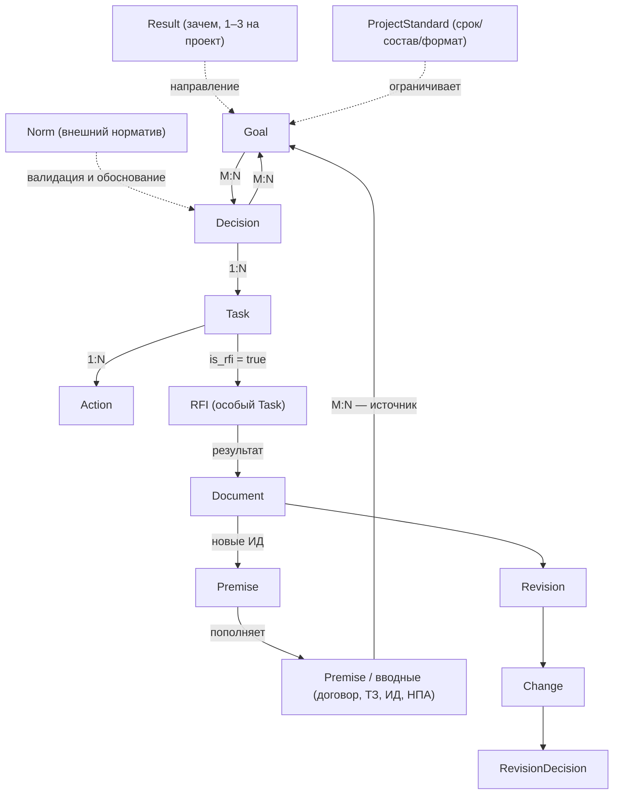
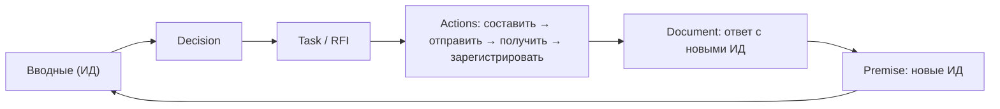

# MASTER_SPEC.md — сквозная спецификация «ГИП-Ассистент»

> **Назначение:** сборка онтологии, пайплайна, архитектуры и стратегии в одну
> картину: как части продукта работают вместе. Не заменяет источники и не
> дублирует их — только связывает.
>
> **Приоритет при расхождении:**
> `DOMAIN.md` → `MASTER_PIPELINE.md` → `ARCHITECTURE.md` →
> `Дорожная_карта_7.0.md` → `TASKS.md`.

**Версия:** 1.0 (draft)
**Дата:** 25.10.2026
**Статус:** активна Веха 4 (RFI); закрыты 6.12a/b/c.

---

## 1. Сквозной сценарий (End-to-End)

### 1.1. Конвейер

Источник: `MASTER_PIPELINE.md §2`. Семь шагов превращают файл в элементы
онтологии и обратно — в ревизию.

| # | Шаг | Вход → выход | Где описано | Статус |
|---|-----|--------------|-------------|--------|
| 1 | Загрузка | файл → `Document` + `DocumentVersion` | `MASTER_PIPELINE.md §2 (шаг 1)` | ✅ веха 1 (6.5) |
| 2 | Парсинг | `file_path` → `text_content` | `§2 (шаг 2)` | ✅ Excel; ⏳ PDF/DOCX — 6.13a |
| 3 | Извлечение | текст → Premise / Goal / Decision / Task | `§2 (шаг 3)` | ✅ правила (веха 1); ⏳ LLM — веха 6 |
| 4 | Связывание | сущности → `Document ↔ Premise` | `§2 (шаг 4)` | ⏳ 6.13b |
| 5 | Валидация | `verification_status` → утверждено ГИПом | `§2 (шаг 5)` | ✅ валидатор-правила; ⏳ GUI — 6.13c |
| 6 | Агент | структура → автономные действия | `§2 (шаг 6)` | ⏳ 6.12e → 6.12f |
| 7 | Ревизии | новая версия → `Revision` + diff | `§2 (шаг 7)` | ✅ сервис/UI; ⏳ 6.13d |

**Ключевое ограничение MVP:** шаг 3 в вехах 1–5 работает **на правилах**,
а не на LLM (`DOMAIN.md §2`, «механизм вывода двухуровневый»). LLM как
механизм вывода — веха 6. 6.14 (админка LLM) — инфраструктура, а не
извлечение структуры.

### 1.2. Сквозной пример: «Сдача тома 7 в экспертизу»

**Дано:** договор на проектирование объекта X, срок сдачи ПД — 01.12.2026.
Том 7 (ОВ) требует расчёта ВК, своего специалиста по ВК нет.

**Шаг 0. Result.** Из предмета договора ГИП фиксирует
`Result` «Сдать ПД и РД по объекту X до 01.12.2026» (`DOMAIN.md §4.0`).
Result — не часть цепочки Goal → Action, а направление для всех Goal.

**Шаг 1. Загрузка.** Договор (PDF) попадает в `Document` +
`DocumentVersion` через drop zone (`MASTER_PIPELINE.md §2, шаг 1`;
`DOMAIN.md §7.1`).

**Шаг 2. Парсинг.** 6.13a извлекает `text_content` (PDF — PyMuPDF,
DOCX — python-docx). До 6.13a работает только Excel.

**Шаг 3. Извлечение.** Правило 1 (договор) читает срок из
`data['deadline']` и предлагает Goal «Сдать том 7 в экспертизу»
(`Дорожная_карта_7.0.md §5.1.3`; `DOMAIN.md §4.1`). После вехи 6 LLM
дополнительно предложит Decision/задачи из текста писем и протоколов
(`DOMAIN.md §9.1`).

**Шаг 4. Связывание.** Договор связывается с `Premise` «Договор №…»
(6.13b; FK `documents.premise_id`, `DOMAIN.md §3.5`).

**Шаг 5. Утверждение.** ГИП видит предложение с доказательством
(источник, страница) и утверждает Goal. Валидатор проверяет Goal →
`ProjectStandard` и Goal → `Result` (`DOMAIN.md §4.4.1`). Статус
`requires_check` — сигнал, а не ошибка (`DOMAIN.md §2.6`).

**Шаг 6. Логика.** Goal «Сдать том 7 в экспертизу» → Decision
«Передать расчёт ВК на субподряд» (обоснование: нет своего специалиста)
→ Task «Получить ИД по нагрузкам на ВК» → Actions «составить запрос»,
«отправить», «получить ответ», «зарегистрировать ИД»
(`DOMAIN.md §4.2–§4.4`, §4.6).

**Шаг 7. RFI.** Для Decision не хватает ИД → Task с `is_rfi = true`
(в БД — `tasks.rfi_state`, `rfi_due_date`, `rfi_cause_decision_id`;
отдельной таблицы `rfis` нет — решение 6.12a, `TASKS.md §5`).
Состояния: `open → sent → answered → registered → closed`, эскалация —
`escalated` (8 эндпоинтов 6.12c). Демо вехи:
`Дорожная_карта_7.0.md §5.4.4`.

**Шаг 8. Пополнение вводных.** Ответ смежника приходит как `Document`
(новые ИД) → `Premise` → доступен как источник для других Goal
(`DOMAIN.md §4.6`, «ИД и RFI» в §3). Цикл замыкается.

**Шаг 9. Агент.** Агент RFI (6.12e) через `gip-mcp-gateway` (6.12f)
проверяет `list_overdue`, эскалирует, пишет `AgentLog`
(`DOMAIN.md §9.2`, §9.2.1; `ARCHITECTURE.md §7.6`). Агент сроков
(веха 5) напоминает о `rfi_due_date` в Telegram.

**Шаг 10. Ревизия.** Смежник присылает новую версию нагрузок и не
уведомляет. `Revision` + `Change`, `notified = false` →
`changed_silently` → стоп-сигнал → `RevisionDecision`
(`DOMAIN.md §3.5`, §4.4.3; `Дорожная_карта_7.0.md §5.1.11`).

### 1.3. Где в сценарии участвует человек

| Этап | Система | ГИП |
|---|---|---|
| Загрузка | сохраняет, версионирует | приносит документ |
| Извлечение | предлагает структуру | утверждает / правит / отклоняет |
| Валидация | показывает evidence / missing | решает по `requires_check` |
| RFI | следит, эскалирует (после 6.12e) | утверждает RFI и ответ |
| Ревизия | находит изменения, стоп-сигналы | выносит инженерное суждение |

Правило: без доказательства система **не действует** автономно, только
предлагает (`DOMAIN.md §2.6`).

---

## 2. Архитектура ядра

### 2.1. Общая схема



Источник: `DOMAIN.md §8` (схема целиком), §3–§4, §7.

### 2.2. Связи и кардинальности

| Связь | Тип | Смысл | Источник |
|---|---|---|---|
| `Goal ↔ Premise` | M:N | ИД — источник для многих Goal | `DOMAIN.md §3.7` |
| `Goal → Premise` | 1:1 | завершённый Goal стал ИД (`Premise.source_goal_id`) | `§3.7` |
| `Result ← Goal` | M:N | Goal формирует Result | `§4.0` |
| `ProjectStandard ↔ Goal` | M:N | стандарт ограничивает Goal, но не порождает | `§3.6` |
| `Goal ↔ Decision` | M:N | одно решение ведёт к нескольким целям | `§4.2` |
| `Decision → Task` | 1:N | задача реализует решение | `§4.3` |
| `Task → Action` | 1:N | Action может быть и вне Task | `§4.4` |
| `Decision ↔ Norm` | M:N | обоснование со ссылкой на норму | `§7.2` |
| `RFI → Document` | 1:N | результат RFI — новые ИД | `§4.6` |
| `Document → Revision → Change` | 1:N | версии файла и их различия | `§3.5` |

### 2.3. Цикл пополнения вводных



Это единственный легальный способ «выращивания» вводных внутри системы:
не редактирование справочника, а результат RFI (`DOMAIN.md §3`, «ИД и RFI»;
§4.6).

### 2.4. Инварианты ядра

1. **RFI не отдельная сущность** — Task с `is_rfi = true`.
   `RfiRepository` — специализация, а не дубль `TaskRepository`
   (граница зафиксирована в `TASKS.md §4`).
2. **Goal → Premise — только если документ станет входом** для других
   Goal. «Сдать том 7» — результат, а не ИД (`DOMAIN.md §3.7`).
3. **`нет данных` ≠ `не соответствует`**. Отсутствие данных — сигнал к
   RFI, а не повод для правдоподобного ответа (`DOMAIN.md §4.4.1`).
4. **`changed_silently` ≠ `принято`**. Нет `notified` — остановка и
   выяснение (`§3.5`, `§4.4.3`).
5. **Одна версия `is_current` на документ** (`AGENTS.md`, правило проекта).
6. **Result/ProjectStandard не порождают Goal** — только направляют и
   ограничивают (`§4.0`, `§3.6`).
7. **Домен чистый:** связи и правила живут в domain, БД — адаптер
   (`ARCHITECTURE.md §1`, §6).

---

## 3. Роль LLM и агентов

### 3.1. Разделение

| | LLM (механизм вывода) | Агент (исполнитель) |
|---|---|---|
| Что делает | понимает текст, предлагает структуру | действует по готовой структуре |
| Вход | вводные / текст документа | проекция данных проекта |
| Выход | предложение (Goal, Decision, Task) | событие: напоминание, RFI, эскалация, лог |
| Кто утверждает | ГИП | ГИП делегировал заранее |
| Где в онтологии | `DOMAIN.md §2`, §9.1 | `DOMAIN.md §9.2` |
| Когда появляется | веха 6 | агент-валидатор — веха 1; агент RFI — 6.12e; сроков — веха 5 |

**Формула:** LLM отвечает на вопрос «что здесь есть?»; агент — «что
теперь делать?». Агент **не выводит** структуру (`DOMAIN.md §9.2`).
Автономия — только в пределах явного делегирования (§9.3).

### 3.2. Где LLM в пайплайне

| Точка | Задача | Статус |
|---|---|---|
| Шаг 3 | текст → доменные сущности | веха 6 |
| Валидатор | доказанность, противоречия | `LLMGoalValidator` — веха 6; сейчас `RuleBasedGoalValidator` |
| Агент-валидатор | протокол 2–3 прогонов | правила сейчас, LLM позже (`§4.4.2`) |

6.14 (админка LLM) даёт **переключаемый провайдер** (`RuntimeLLMAdapter`,
`LLMProviderPort`, светофор `Project.data_security_level`,
`ARCHITECTURE.md §7.5`), но не включает извлечение структуры. Это важно:
«админка LLM» ≠ «LLM работает в пайплайне».

### 3.3. Маршрут агента и изоляция

```text
[Контейнер агента] → MCP → [gip-mcp-gateway] → [Agent Gateway] → [Существующий API] → [БД/MinIO]
```

(`ARCHITECTURE.md §7.6`)

- **Agent Gateway** — аутентификация агента отдельным токеном, проверка
  периметра, проекция данных, аудит (`AgentLog`).
- **gip-mcp-gateway** — единственный MCP-сервер: Resources/Tools,
  фиксированный набор операций («прочитать замечания», «создать RFI»,
  «отправить уведомление»), проверка прав, лог. Сторонние MCP запрещены
  (`DOMAIN.md §9.2.1`).
- **Песочница** — отдельный контейнер, read-only root FS, лимиты,
  egress только к gateway (`ARCHITECTURE.md §7.6`).

### 3.4. Периметр (проекция)

| Агент | Видит | Не видит |
|---|---|---|
| Сроков | `deadline` Goal/Task/Action, `rfi_due_date` | тексты документов, `Premise.data` |
| RFI | Decision без ИД, факт наличия Premise | полные тексты договоров |
| Валидатор | текст замечаний из MinIO (read-only) | остальные тома |

Источник: `DOMAIN.md §9.2.1`. Правило: за пределами проекции — **запрос**
через gateway, не прямое чтение.

**Текущее состояние:** до 6.12f агенты работают в режиме «только чтение
через существующий API» (`TASKS.md §4`).

---

## 4. Границы MVP

### 4.1. Вехи 4–6

| Веха | Сейчас / когда | Что входит | Выход |
|---|---|---|---|
| **4. RFI** | **сейчас** (6.12a–c ✅) | 6.12d UI; 6.12e агент RFI; 6.12f gateway; плюс вклиниваются 6.14a–d и 6.13a–d | RFI → Document → новые ИД (`Дорожная_карта_7.0.md §5.4.4`) |
| **5. Сроки** | следующая | `ReminderSettings`/`ReminderLog`, `DeadlineService`, агент сроков на правилах, `deadline_worker`, Telegram-команды и digest, `DeadlineDashboardPage`, дашборд «что горит» (§5.1.12) | просрочки видны, напоминания приходят (`§5.5.4`) |
| **6. Пилот** | потом | Qwen 2.5 7B, LLM как механизм вывода, локальный RAG, XML + XSD, MinIO (если не раньше), Auth (JWT + Argon2), деплой VPS, лендинг, 152-ФЗ, пилот 7 дней | метрики `DOMAIN.md §2.5`, SUS ≥ 80 |

Разделение «сейчас / следующая / потом» — из
`Дорожная_карта_7.0.md §4`; статус — `TASKS.md §2–§3`.

### 4.2. Дельты, которые вклиниваются

Порядок (`TASKS.md §3`, `MASTER_PIPELINE.md §5`):

```text
6.12d → 6.14a–d → 6.13a–d → 6.12e → 6.12f
```

| Дельта | Что | Почему здесь | Источник |
|---|---|---|---|
| **6.14a–d** | LLM-админка: `llm_settings`, адаптеры, `/api/admin/llm/*`, `AdminLLMPage` | без переключаемого провайдера и светофора нельзя демонстрировать LLM-инфраструктуру; извлечение структуры остаётся на веху 6 | `TASKS.md §3 (6.14)`; `ARCHITECTURE.md §7.5` |
| **6.13a** | парсинг PDF/DOCX + `text_content` | шаг 2 конвейера | `MASTER_PIPELINE.md §2 (шаг 2)` |
| **6.13b** | `PremiseService.link_document()` | шаг 4; без связей агент RFI не видит источник ИД | `§2 (шаг 4)` |
| **6.13c** | кнопка «Подтвердить» в `PremiseCard` | шаг 5; замыкает цикл «предложено → утверждено» | `§2 (шаг 5)` |
| **6.13d** | `RevisionDiffPanel` | шаг 7; нужен для `changed_silently` | `§2 (шаг 7)` |

6.13 расширяет веху 1 по смыслу, но ставится до 6.12e: агент RFI без
парсинга и связывания работает «вслепую».

### 4.3. Вне 7.0

- Явная сущность «Метод управления» — вопрос 12, решается в вехе 3
  (`Дорожная_карта_7.0.md §7`).
- Согласования, РВИ, тома, финансы (MVP-2), интеграции (MVP-4),
  мобильное приложение, мультитенантность, on-premise, самописный агент
  на GigaChat API — после пилота (`§7`).
- Остальные агенты (связей, норм, XML) — после пилота; в MVP один агент
  сроков + агент RFI (`§5.5.3`, вопрос 10).

---

## 5. Технический долг и риски

Источник списка: `TASKS.md §4` («Известные ограничения»).

### 5.1. Четыре ключевых долга

| Долг | В чём проблема | Почему возник | Когда чинить |
|---|---|---|---|
| **Двойная enum-конвенция** | `RfiState` маппится через `.value` (`'open'`…), `GoalState` / `DecisionState` / `PremiseCategory` — через `.name` (`'PLAN'`…) | вехи 1–3 закрепили `.name`; 6.12a ввёл `RfiState` со строковыми значениями, единую конвенцию не зафиксировали | после вехи 4: привести к `.value` (решение в `TASKS.md §4`), рефакторинг репозиториев + smoke-тесты |
| **N+1 в `TaskRepository`** | `get_by_project` / `get_by_pair` / `get_overdue` / `get_upcoming` делают `_fetch_premise_ids` на каждый RFI-ряд | простая реализация связи `goal_premises`; оптимизация отложена | 6.12e или сразу после вехи 4: batch `IN` / `selectinload`; до этого `list_overdue` агента RFI будет медленным |
| **Дрейф типов** | `project_standards.value` (JSON → JSONB), `result_goals.created_at` / `standard_goals.created_at` (TIMESTAMP → DateTime) | модели менялись быстрее миграций (ещё до 6.12a); `alembic check` подтверждает | сейчас — вручную вычищать из autogenerate; отдельная задача «fix pre-existing type drift» — после вехи 4 |
| **Циклические FK `actions ↔ documents`** | `actions.result_document_id` + `documents.trigger_action_id` дают SAWarning «unresolvable cycles»; autogenerate не сравнивает эти FK | осознанный риск спеки `spec_week_4.md §2.3`: Action порождает документ и документ порождает Action | постоянно: изменения FK — только явными `op.create_foreign_key` / `op.drop_constraint`, не autogenerate |

### 5.2. Остальные долги

| Долг | Риск | Когда |
|---|---|---|
| `RfiRepository` использует private-члены `TaskRepository` (`_fetch_premise_ids`, `_to_domain`) | сломается при рефакторинге Task | вместе с рефакторингом `TaskRepository` |
| `TaskRepository.get_by_pair` без `@abstractmethod` (B027) | порт и реализация расходятся | cleanup репозиториев |
| `decision_id` в домене Task — отклонение от `spec_week_3.md §2.1` | домен знает о Decision, которого спека не предполагала | решено узаконить/откатить в 6.11e — зафиксировать итог |
| Fixture `TestGoalPremiseIdsIntegration` делает COMMIT | нарушение изоляции тестов | отдельная задача после вехи 4 |
| `API.md` не полон; `DATABASE.md` — дубли §2.17–2.19 | ИИ-контекст врёт о фактическом API/схеме | docs-pass; влить в ближайшую задачу |
| ESLint не настроен; GitHub Actions для автогенерации docs нет | качество frontend и дрейф документации | после пилота / по мере надобности |

### 5.3. Риски сборки

1. **Обещание LLM раньше вехи 6.** В демо вехи 4 нельзя говорить «LLM
   извлекает структуру»: 6.14 — только инфраструктура. Предложения до
   вехи 6 — правило-базированные и помечены `requires_check`.
2. **Агент без gateway.** До 6.12f автономность запрещена; агент RFI
   работает read-only через существующий API (`TASKS.md §4`).
3. **Вклинивание 6.13a–d раздувает веху 4.** Митигация: каждая дельта —
   отдельный план и коммит (`AGENTS.md`, «маленькие шаги»).
4. **Доверие к `changed_silently` зависит от дисциплины `notified`.**
   Если флаг выставлен неверно, ГИП видит ложное «принято». Митигация:
   контроль входа (уровень 1) и стоп-правила (`DOMAIN.md §4.4.3`).
5. **Расхождения в источниках** (фиксируются, а не сглаживаются):
   - агент RFI: `TASKS.md §3` — веха 4 (6.12e), `Дорожная_карта_7.0.md
     §5.4.5` — «веха 5»;
   - шаг 3 (извлечение LLM): `MASTER_PIPELINE.md §3` помечает «веха 4»,
     §3 той же таблицы — «веха 6, не запланировано»; дорожная карта —
     веха 6;
   - `DOMAIN.md`: шапка v1.2, финал — «v1.1»; `Дорожная_карта_7.0.md §9`
     ссылается на `docs/archive/`, который не ведётся (`docs/README.md §7`).

   Решение по каждому — за координатором; данная спека принимает
   приоритет `DOMAIN.md` и порядок подсессий из `TASKS.md`.

---

**Конец MASTER_SPEC.md v1.0 (draft).**
